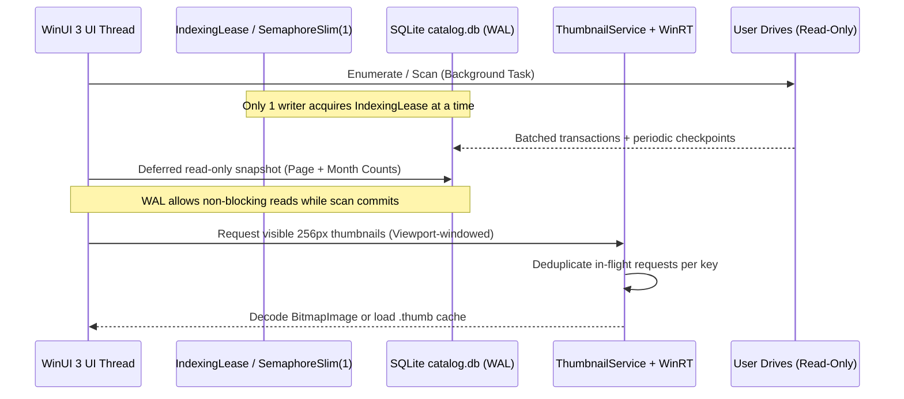

# Luma Architecture Assessment

As-built technical map of Luma on branch `feat/v0.7.0-trust-speed-and-viewing` (`70d13ed`), verified directly against `src/` and `tests/`.

## 1. Layered Solution Structure

```
+-----------------------------------------------------------------------+
|                       Luma.App (WinUI 3 / WinAppSDK)                  |
| MainWindow.xaml + partial code-behind modules:                        |
|  - MainWindow.Gallery.cs (virtualized grid, Adaptive/Moments rows)    |
|  - MainWindow.Organization.cs (Favorites, Tags, Albums, Copy/Move)    |
|  - MainWindow.Management.cs (Sources, Refresh, Repair, Rebuild)       |
|  - MainWindow.Offline.cs (Prepare, Clear Cache, Reconnect status)     |
|  - MainWindow.Exclusions.cs, MainWindow.Place.cs, MainWindow.Map.cs   |
|  - DiskGuard.cs, AppSettings.cs, PathRedactor.cs, ShellFiles.cs       |
+------------------------------+----------------------------------------+
                               | Calls Core & Windows services
            +------------------+------------------+
            v                                     v
+-----------------------------------+  +--------------------------------+
|     Luma.Core (.NET 8, cross)     |  |    Luma.Windows (.NET 8 Win)   |
| - MediaCache (SQLite WAL + FTS?)  |  | - WindowsSourceResolver        |
| - LibraryQueries (paging/counts)  |  |   (Volume GUID / DiskId / path)|
| - ResumableIndexing (checkpoints) |  | - WindowsMetadataReader        |
| - ThumbnailCache (LRU flat files) |  |   (WinRT Properties, Storage)  |
| - ThumbnailService (dedup/decode) |  | - WindowsThumbnailGenerator    |
| - TagManagement, Organization     |  |   (StorageItem thumbnails)     |
| - ExternalReconciliation          |  +--------------------------------+
| - SmartCollections, PhotoStacks   |
| - MapOverview, MinimalGpsExtractor|
| - Exclusions, BrowsePosition      |
+-----------------------------------+
            |
            v
+-----------------------------------------------------------------------+
|              Local Storage (%LOCALAPPDATA%\Luma by default)           |
| - catalog.db (+ -wal/-shm, .bak)   SQLite catalog, IDs, checkpoints   |
| - cache\<64-char-hex>.thumb        Flat binary LRU thumbnail store     |
| - settings.json                    Preferences, layout, cache ceiling  |
| - last-transfer.json               Last Move/Copy undo journal        |
| - last-error.txt / crash.log       Diagnostic crash/action logs       |
+-----------------------------------------------------------------------+
```

Note on drift corrected during assessment: `docs/swarm/ARCHITECTURE_MAP.md` (line 95) previously described thumbnails as nested under `cache/<key[0..1]>/<key[2..3]>/<key>.thumb`. Direct inspection of `src/Luma.Core/ThumbnailCache.cs` shows thumbnails are stored flat at `<cacheDir>/<64-char-sha256>.thumb` alongside a persisted SQLite/index tracking last access and size.

## 2. Data Model & Durable Identity (`catalog.db`)

Core tables managed by `MediaCache` (`SchemaVersion` currently v7, WAL mode, `busy_timeout = 5000`, backup snapshot `catalog.db.bak` via SQLite Online Backup API):

1. **`sources`**: `Id` (stable `VolumeGuid` / disk fingerprint / path hash), `RootPath`, `DisplayName`, `VolumeLabel`, `LastOnlineUtc`, `IsExcluded`.
2. **`media_ids`**: Persistent surrogate `MediaId` mapped to `(SourceId, RelativePath)`. Moving or renaming within Luma calls `MediaCache.RelocateAsync` so `MediaId` stays attached to favorites, tags, and albums.
3. **`media`**: `SourceId`, `RelativePath`, `FileName`, `Extension`, `SizeBytes`, `ModifiedTicks`, `CapturedTicks`, `Width`, `Height`, `DurationMs`, `MimeType`, `ContentHash` (when computed), `Latitude`, `Longitude`, `LocationLabel`, `MediaType`, `BatchId` / scan markers.
4. **`annotations`**: `SourceId` + `RelativePath` (or `MediaId` linkage) holding `Favorite`, `Tags` (normalized comma/semicolon-separated strings, normalized with bug fixed to preserve spaces inside tags), `Rating`, etc.
5. **`albums` / `album_items`**: Virtual collections referencing persistent media identities so albums survive drive-letter swaps and relocations.
6. **`exclusions`**: `Kind` (`source`, `folder`, `extension`) + normalized pattern.
7. **`indexing_checkpoints`**: Directory cursor / completed batch state for pause/resume/crash recovery, governed by `IndexingLease` in `ResumableIndexing.cs`.

## 3. Threading & Concurrency Model



Key threading truths verified in `src/` and `tests/Luma.Tests/GalleryTests.cs`:
- Gallery reads run inside deferred read-only transactions (`LibraryQueries`), allowing browsing, search, and month counts to remain responsive while a background scan holds the writer slot.
- `MainWindow.Gallery.cs` enforces viewport-windowed card realization (`RealizeVisibleWindow`) so even 100k+ item libraries materialize only a narrow band of XAML `MediaCard` elements around the scroll offset.
- Known race/re-entrancy risks identified in this audit: `UpdateEmptyState` (`async void` lacking a check against concurrent query swaps), `DiskGuard` blocking even warm `.thumb` reads on low disk, and `ReviewLastTransfer` undo running full `ScanAsync` instead of atomic `RelocateAsync`.

## 4. External Drive & Offline Browsing Pipeline

1. **Identity Resolution (`WindowsSourceResolver`):** Attempts canonical volume GUID -> volume serial/label -> folder path fallback. Returning drives with new Windows letters (e.g., `E:` -> `G:`) remap cleanly without losing tags, albums, or thumbnails.
2. **Reconnect Lifecycle:** App activation, idle checks, and manual Refresh probe roots (`ResolveRoot`). State updates happen in place via `MediaCard.Online` without forcing full gallery reload, and missing visible previews retry automatically.
3. **Offline Mode:** Catalog entries and cached `<hash>.thumb` files remain browsable when disconnected. Editing favorites, tags, and virtual albums works offline inside `catalog.db`. Original-file operations (`Open`, `Reveal`, `Copy`, `Move`, `Rename`, `Delete`) require live access to originals and explain connectivity status cleanly.

## 5. Security, Trust & Privacy Boundaries

- **Strictly read-only indexing:** `ResumableIndexing`, `WindowsMetadataReader`, `MinimalGpsExtractor`, and `ThumbnailService` never open user originals with write access.
- **Original mutations only by user command:** Copy/Move use `FileTransfer` (zero silent overwrites; skips collisions). Delete delegates to Windows `SHFileOperation` (`FO_DELETE` + `FOF_ALLOWUNDO`) to invoke the Windows Recycle Bin confirmation dialog.
- **No unsolicited network calls:** Default Map view uses bundled vector map geometry (`OfflineWorldMap` + `map.html`). Optional online tiles require explicit user toggle. Feedback opens the user's browser via `https://github.com/smile-plzz/Luma-windows-software/issues/new` only when clicked.
- **Crash/error logs:** `App.LogCrash` runs `PathRedactor.Redact` to strip user profile/drive folder paths; `MainWindow.Guard` is being aligned to redact `last-error.txt` identically.

